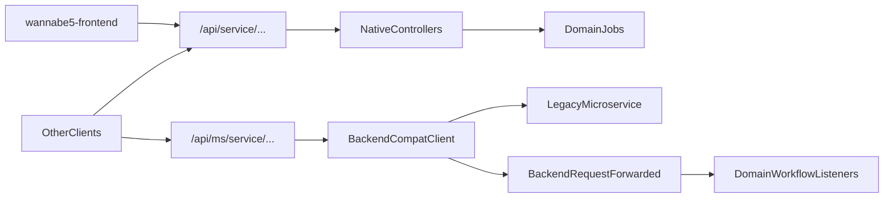

# Architecture Overview

## Core Shape

`wannabe5-core` is the consolidation API for Wannabe5. It exposes:

1. **Native domain APIs** under `/api/{service}/...` (preferred for `wannabe5-frontend` and new clients).
2. **Core resources** such as pages, UserProfile search/show/update, and metrics.
3. **Compatibility adapter** under `/api/ms/{service}/...` that can still forward to legacy microservices during cutover.

## Native Domain Prefixes

| Prefix | Domain |
|---|---|
| `/api/auth` | Keycloak OIDC login/register/callback, refresh-session, service login |
| `/api/access` | Users, attributes, attribute-types, `_internal/access` |
| `/api/application` | Applications, questions, answers, comments, status transitions |
| `/api/communication` | Messages, templates, notifications, lists, delivery pipeline |
| `/api/crew` | Events, crews, users, teams, pages |
| `/api/profile` | Legacy profile-service surface (search, nested profile/images) **and** core UserProfile `{numeric\|uuid}` |
| `/api/profileservice` | Explicit alias of the profile-service surface (docs/tests) |
| `/api/tasking` | Event/user/crew tasks, responses, approvals |

Domain logic and parity workflows live under `app/Domain`. HTTP entrypoints live under `app/Http/Controllers`. Routes are declared in `routes/api.php`.

## Request Paths

## Compatibility Adapter

Legacy adapter routes remain available:

- `/api/ms/access/...`
- `/api/ms/application/...`
- `/api/ms/auth/...`
- `/api/ms/communication/...`
- `/api/ms/crew/...`
- `/api/ms/profile/...`
- `/api/ms/tasking/...`

Upstream bases are configured via `BACKEND_COMPAT_*_URL` in `.env`. Route surfaces are declared in `config/backend_compat_routes.php`.

## Domain Workflow Hooks

Current async hooks:

- application status transitions → `HandleApplicationStatusTransition`
- auth session / OIDC flows → `HandleProfileSyncFromAuth`
- communication prepare/send → `PrepareAndSendMessage` (+ mail/SMS/Slack providers)

Cross-adapter side effects are also triggered from `BackendRequestForwarded` when `/api/ms/*` is used.

## Frontend Cutover

`wannabe5-frontend` already calls `/api/{service}/...` (not `/api/ms/...`). Point `API_URL` / `API_PROXY_DESTINATION` at core. See `docs/parity/frontend-cutover.md` and `docs/testing/e2e.md`.
